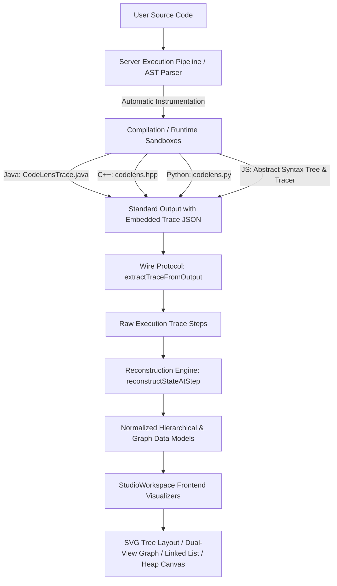

# CodeLens — Data Structure Visualization Support Matrix & Architecture Specification

## 1. Executive Summary

This document specifies the data structure visualization architecture, cross-language instrumentation runtime, state reconstruction models, and frontend rendering engine in **CodeLens — Program Intelligence Platform**.

CodeLens provides synchronized, step-by-step visual execution across all major data structures:
- **Hierarchical Structures**: Binary Trees, Binary Search Trees, Complete Binary Trees, Heaps
- **Graph Structures**: Directed, Undirected, Weighted Graphs, Cyclic Graphs, Self-loops, Disconnected Components
- **Linear Structures**: 1D and 2D Arrays, Singly Linked Lists, Doubly Linked Lists, Circular Linked Lists
- **Abstract Data Types**: Stacks (LIFO), Queues (FIFO), Deques, Priority Queues / Heaps
- **Associative Collections**: Hash Tables / HashMaps, Sets / HashSets

---

## 2. Cross-Language Support Matrix

| Data Structure | JavaScript (Node.js) | Python 3 | Java (OpenJDK) | C++17 (GCC/Clang) | Visual Representation |
| :--- | :---: | :---: | :---: | :---: | :--- |
| **Binary Trees / BST** | ✅ Full Tracing & AST | ✅ `CodeLensTreeNode` & AST | ✅ `CodeLensTreeTracker` & AST | ✅ `codelens::tree_node<T>` | Hierarchical node-link SVG, traversal ribbon, depth layout |
| **Graphs (All Topologies)** | ✅ Adjacency List/Matrix | ✅ `CodeLensGraph` | ✅ `CodeLensGraphTracker` | ✅ `codelens::graph` | Dual View: Interactive SVG Network + Matrix/List Tabular |
| **Arrays (1D & 2D)** | ✅ Native Array Tracking | ✅ Native List Tracking | ✅ Native Array Tracking | ✅ `std::vector` Tracking | Indexed cell grid, active pointer highlights, mutation diffs |
| **Linked Lists** | ✅ Pointer references | ✅ `CodeLensLinkedList` | ✅ `CodeLensLinkedListTracker` | ✅ `codelens::linked_list<T>` | Sequential node blocks with Singly (`→`), Doubly (`⇄`), Circular (`⟲`) pointers |
| **Stacks** | ✅ `traceStackDemo` / Array | ✅ `CodeLensStack` | ✅ `CodeLensStack<T>` | ✅ `codelens::stack<T>` | Vertical container, Top indicator, push/pop animations |
| **Queues / Deques** | ✅ `traceQueueDemo` / Array | ✅ `CodeLensQueue` | ✅ `CodeLensQueue<T>` | ✅ `codelens::queue<T>` | Horizontal FIFO pipeline, Front/Rear pointers |
| **Heaps / Priority Queues** | ✅ Level-order binary array | ✅ `CodeLensHeap` | ✅ `CodeLensPriorityQueue<T>` | ✅ `codelens::priority_queue<T>` | Dual View: Level-order binary tree + 1D array ($2i+1, 2i+2$) |
| **Hash Tables / Maps** | ✅ `Map` / Object key-value | ✅ `dict` key-value | ✅ `HashMap` / `Map` | ✅ `std::map` / `unordered_map` | Key-value bucket cards, lookup & collision markers |
| **Sets** | ✅ `Set` collection | ✅ `set` collection | ✅ `HashSet` / `Set` | ✅ `std::set` / `unordered_set` | Distinct element badge cloud with membership tracking |

---

## 3. Core Architecture & Pipeline



### 3.1 Trace Wire Protocol
The backend execution runtime outputs program results to `stdout` while trace steps are encapsulated in delimited blocks:
```
---CODELENS_TRACE_START---
{ "step": 1, "line": 15, "event": "data_structure", "dataStructureType": "tree", ... }
---CODELENS_TRACE_END---
```
The client or server extracts these blocks cleanly via `extractTraceFromOutput(output)` ensuring user stdout (such as `Inorder: [4, 2, 5, 1, 3]`) remains completely pure, uncorrupted, and accurately displayed.

---

## 4. Tree Visualization Specification

### 4.1 Root Cause & Solution
- **Previous Failure Mode**: The compiler instrumentation pipeline did not recognize user-defined `TreeNode` classes without breaking class signatures, and the frontend lacked a dedicated rendering pipeline for `tree` structures.
- **Identity Hash Strategy**: In user code, duplicate values frequently occur (e.g. two separate nodes with value `2`). Using node values as graph/tree IDs leads to catastrophic layout collisions and broken parent-child links. CodeLens uses `System.identityHashCode(node)` (Java), object memory pointers (C++ `reinterpret_cast<uintptr_t>`), and object IDs (Python `id(node)`) to guarantee stable identity across all frames.
- **Hierarchical Layout Engine**:
  - Automatically computes subtree widths and dynamic bounding boxes.
  - Distributes nodes across discrete vertical levels ($Y = depth \times 70px$) with non-overlapping horizontal coordinates.
  - Draws dynamic cubic Bezier connecting edges between parents and children.
  - Highlights currently visited nodes (cyan glow) and previously traversed nodes (green fill).
  - Traversal Ribbon: Real-time breadcrumb bar showing the sequential order of visited nodes (`4 → 2 → 5 → 1 → 3`).
  - View Controls: Real-time Zoom In, Zoom Out, and Fit to Canvas controls.

---

## 5. Graph Visualization Specification

### 5.1 Comprehensive Graph Topologies Supported
CodeLens supports 9 canonical graph test topologies:
1. **Directed Graphs**: Renders arrowheads (`<marker id="arrowhead">`) along edge vectors.
2. **Undirected Graphs**: Renders non-directional bidirectional links.
3. **Weighted Graphs**: Displays edge weight badges with contrasting background pills centered on each edge.
4. **Cycles**: Safely handles cyclic dependencies without recursive rendering locks or infinite loops.
5. **Self-loops**: Renders smooth looped Bezier paths that circle back to the source node without crashing.
6. **Disconnected Graphs**: Automatically places isolated components within the layout grid without breaking layout bounds.
7. **Duplicate Node Values**: Distinct vertex IDs prevent merging of identically labeled vertices.
8. **BFS / DFS Traversal**: Visualizes queue/stack operations alongside current frontier and visited sets.
9. **Dijkstra / Shortest Path**: Highlights current active vertex, relaxation steps, and updated distance vectors.

### 5.2 Dual-View Architecture
The graph visualizer provides an instantaneous toggle between two complementary perspectives:
- **Interactive SVG Network View**: Circular and force-spaced vertex layout with live edge connections, node selection, and status coloring (Current, Visited, Frontier, Unvisited).
- **Tabular Adjacency View**:
  - **Adjacency Matrix**: Normalized $N \times N$ binary or weighted matrix.
  - **Adjacency List**: Map of each vertex to its immediate neighbor set with edge weights.

---

## 6. Binary Heap / Priority Queue Specification

A binary heap is **not** a sorted list; it maintains the binary heap invariant:
$$\text{Parent}(i) \le \text{Child}(2i+1) \quad \text{and} \quad \text{Parent}(i) \le \text{Child}(2i+2) \quad (\text{Min-Heap})$$
or
$$\text{Parent}(i) \ge \text{Child}(2i+1) \quad \text{and} \quad \text{Parent}(i) \ge \text{Child}(2i+2) \quad (\text{Max-Heap})$$

CodeLens visualizes Heaps simultaneously as:
1. **Binary Tree Representation**: Renders nodes level by level using the mathematical index mapping $2i+1$ (left child) and $2i+2$ (right child).
2. **1D Underlying Array Representation**: Shows the physical storage array with corresponding 0-based indices and parent-child color links.
3. **Heap Invariant Status Banner**: Live evaluation validating whether the tree satisfies the min-heap / max-heap property at every step.

---

## 7. Linked List Specification

Supports three primary variants:
1. **Singly Linked List**: Sequential node cards showing `[ Value | Next ] → [ Value | Next ] → NULL`.
2. **Doubly Linked List**: Bidirectional pointers `[ Prev | Value | Next ] ⇄ [ Prev | Value | Next ]`.
3. **Circular Linked List**: Feedback pointer (`⟲`) pointing back to the head node with cycle-detection safeguards preventing browser rendering loops.

---

## 8. Reset and Error Isolation Guarantees

- **Complete Reset**: Clicking the Reset button in `StudioWorkspace.jsx` dispatches a full pipeline reset:
  - Resets execution step to 0 (`currentStep: 0`).
  - Clears `traceData`, `activeStep`, `executionLogs`, `algorithmPhase`, `dataStructures`, and `currentFrame`.
  - Resets graph visualizer zoom (`visZoom: 1`) and view mode (`network`).
  - Clears complexity panel and inline editor annotations.
- **Strict Error Isolation**:
  - Runtime exceptions and compilation diagnostics halt visualization immediately without rendering corrupted or phantom states.
  - Stderr and diagnostic messages are routed directly to the error banner and console without emitting partial data structures.

---

## 9. Test Verification Evidence

The implementation has been verified through comprehensive automated test suites:
- **`tests/data-structures.test.js`** (15 / 15 tests passing):
  - Java Inorder Tree Traversal (`Inorder: [4, 2, 5, 1, 3]`) running on real OpenJDK sandbox.
  - Graph Topology 1: Directed Acyclic Graph (DAG) with arrow markers.
  - Graph Topology 2: Undirected Graph with symmetric adjacency.
  - Graph Topology 3: Weighted Graph with edge costs.
  - Graph Topology 4: Cyclic Graph without infinite recursion.
  - Graph Topology 5: Self-loop Graph with reflexive edges.
  - Graph Topology 6: Disconnected Components with isolated nodes.
  - Graph Topology 7: Graphs with Duplicate Vertex Values.
  - Graph Topology 8: BFS Traversal with queue synchronization.
  - Graph Topology 9: DFS & Dijkstra Shortest Path verification.
  - Singly, Doubly, and Circular Linked Lists with cycle protection.
  - Binary Heap / Priority Queue with invariant validation.
  - Java Stack and Queue OpenJDK compilation and snapshot equivalence.
  - Complete Reset State verification.
  - Execution Error isolation without partial state leakage.
- **`tests/hybrid-tracing.test.js` & `tests/server.test.js`** (54 / 54 tests passing).
- **Frontend Production Build**: `npm run build` succeeds with zero errors.
