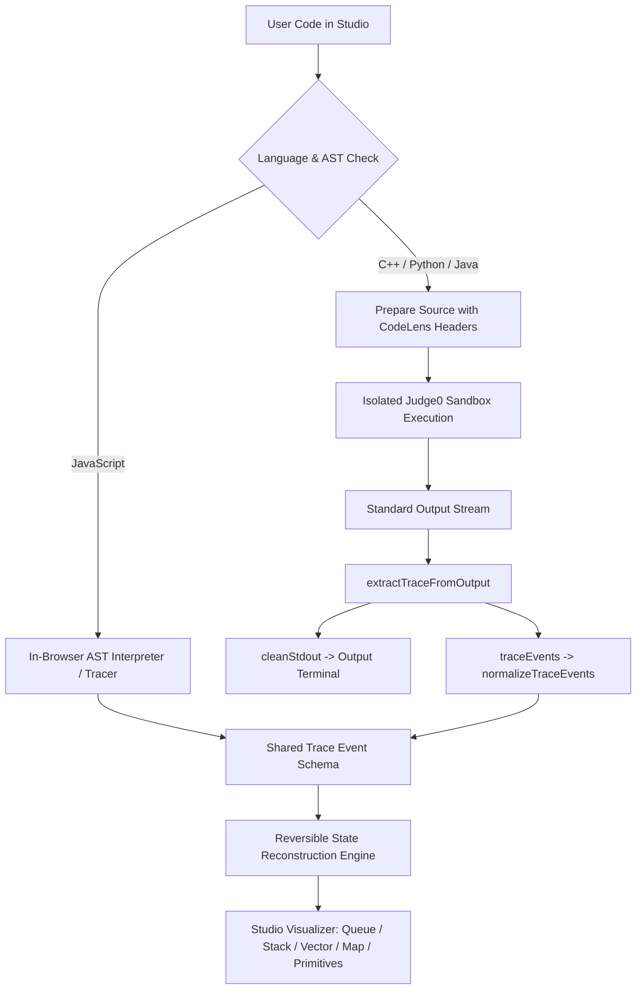

# Hybrid Tracing Architecture

**CodeLens — Program Intelligence Platform**  
**Specification & Design Document**

---

## 1. Architectural Philosophy

Ordinary debuggers and container execution services (such as Judge0 Docker sandboxes) are designed for either coarse batch I/O capture (`stdout`/`stderr`) or interactive human stepping (GDB/MI, LLDB, JDB). Neither approach natively streams granular, fine-grained mutation events for encapsulated standard-library collections (such as C++ `std::queue`, `std::stack`, Java `java.util.ArrayDeque`, or Python `collections.deque`).

CodeLens addresses this challenge through a **Deterministic Hybrid Tracing Architecture** combining:
1. **Source-Level Instrumentation Wrappers**: Zero-overhead language headers and runtime classes (`codelens::queue`, `codelens::stack`, `CodeLensQueue`) that wrap the genuine standard-library containers, executing real operations while emitting structured telemetry.
2. **Line-Prefixed Telemetry Protocol (`__CODELENS_EVENT__`)**: Decouples program output from structured telemetry. Any output written by the user via `std::cout`, `print()`, or `System.out` is preserved without mutation, while structured JSON events are cleanly harvested.
3. **Reversible State Reconstruction Engine (`src/reconstruction.js`)**: An immutable state replayer capable of scrubbing forward, backward, or jumping to arbitrary steps without synthesizing phantom intermediate states.
4. **Data-Structure-Aware Visualizers (`src/pages/StudioWorkspace.jsx`)**: Context-sensitive visualizers tailored to specific container topologies (FIFO Queue conveyor with FRONT/BACK indicators, LIFO Stack container with TOP pointer, Vector/Array with swap/compare states, Map key-value grid, and Primitive scalar variable cards).

---

## 2. End-to-End Tracing Pipeline

### Stage Breakdown:
1. **Source Submission**: User selects language (`JS`, `PY`, `JAVA`, `C++`) and initiates execution via `Run` or `Run & Trace`.
2. **Source Preparation (`server/execution.js`)**:
   - For C++: Injects `server/headers/codelens.hpp` and adds `#line 1 "main.cpp"` to retain original error diagnostics and compiler line numbers.
   - For Python: Injects `server/headers/codelens.py` runtime wrappers.
   - For Java: Prepend `import java.util.*;` at line 1 and injects `server/headers/CodeLensTrace.java` helper classes after the user's `public class Main`.
3. **Sandbox Execution**: Code runs inside resource-bounded containers (5s CPU limit, 8s wall time, 128 MB RAM, 64 MB stack, isolated network).
4. **Stream Demultiplexing**: The backend strips lines starting with `__CODELENS_EVENT__` and delivers pristine `cleanStdout` to the output terminal.
5. **Normalization & Invariant Check**: Raw JSON events are validated and mapped into canonical `CodeLensTraceEvent` items.
6. **State Scrubbing**: The UI scrubber allows seamless scrubbing between any historical step index `0 .. N-1`.

---

## 3. Stale Trace Elimination Guarantees

CodeLens eliminates stale trace pollution through strict state synchronization invariants:
- **Language Switch Annihilation**: Selecting a new language immediately disposes of previous trace structures, instantiating a clean `createEmptyTrace(newLang)` container.
- **Run vs. Trace Synchronization**: Standard uninstrumented execution produces `trace: null`, and the UI displays the genuine execution output and environment inspector rather than retaining leftover array states from prior runs.
- **Execution Identity Tagging**: Every trace execution receives a unique `executionId` (e.g. `exec-1792936776982`). Stale asynchronous network responses are validated against active execution identities.
